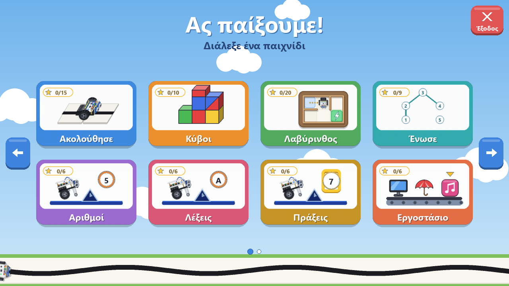
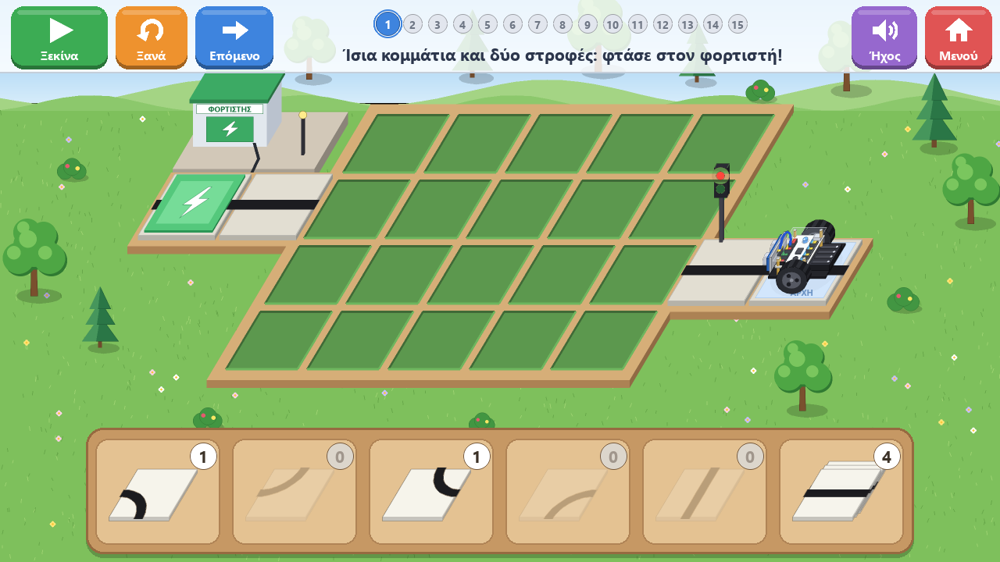
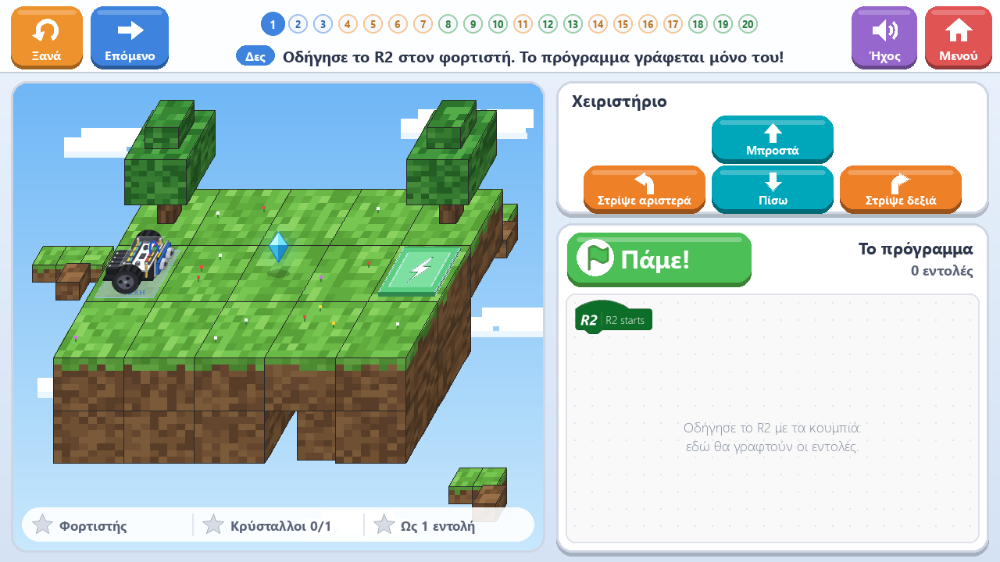
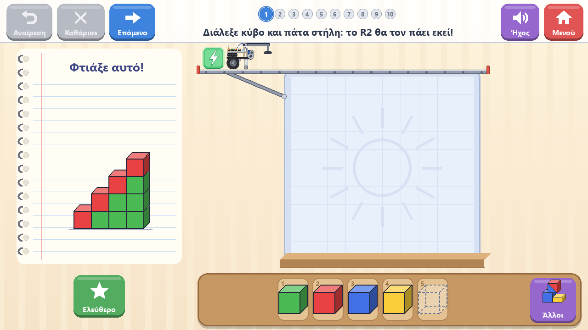
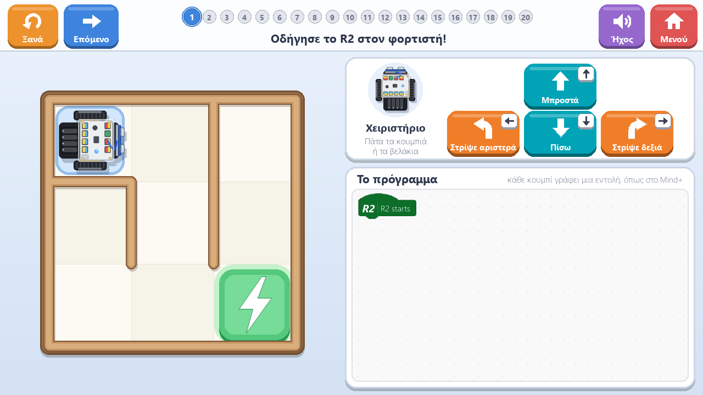
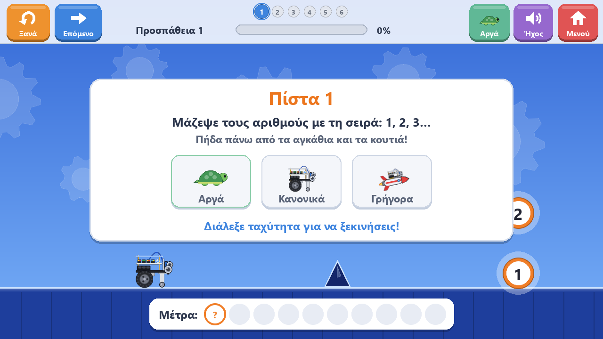
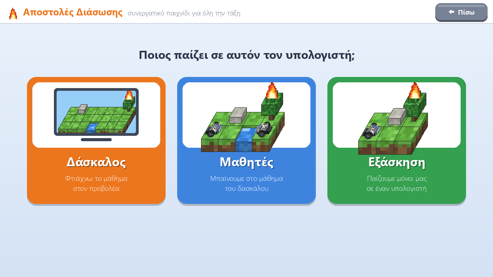

# Εργαστήρι R2 (R2 Lab)

Παιχνίδια ρομποτικής και μάθησης για παιδιά, με ήρωα το ρομπότ R2. Γραμμένα σε Python + pygame.
Τρέχουν σε Windows 10/11 και σε Ubuntu / Xubuntu (και κάθε Linux με Python 3.10+ και pygame), χωρίς internet.

Είναι **ελεύθερο λογισμικό** (άδεια [GPL-3.0](LICENSE)): κάθε εκπαιδευτικός μπορεί να το κατεβάσει, να το
χρησιμοποιήσει στην τάξη, να το αλλάξει και να το μοιραστεί.

**[Κατέβασε την τελευταία έκδοση](../../releases/latest)** · [Ιδέες και προβλήματα](../../issues) · [Πώς βοηθάω](CONTRIBUTING.md)



## Τα παιχνίδια

| Παιχνίδι | Τι κάνει το παιδί | Πίστες |
| --- | --- | --- |
| **Ακολούθησε** | Φτιάχνει με πλακάκια τη μαύρη γραμμή που θα ακολουθήσει το R2 ως τον φορτιστή. | 15 |
| **Κύβοι** | Χτίζει ένα σχέδιο με κύβους· το R2 πηγαίνει κάθε κύβο στη στήλη του. | 10 |
| **Λαβύρινθος** | Οδηγεί το R2 με βελάκια ως τον φορτιστή· οι κινήσεις γράφονται ως μπλοκ του Mind+. | 20 |
| **Ένωσε** | Ενώνει τις τελείες με τη σειρά 1, 2, 3… και η ζωγραφιά ζωντανεύει. | 9 |
| **Αριθμοί** | Τρέξιμο με άλματα: μαζεύει τους αριθμούς με τη σωστή σειρά. | 6 |
| **Λέξεις** | Το ίδιο τρέξιμο: γράφει λέξεις γράμμα γράμμα, με παγίδες ορθογραφίας. | 6 |
| **Πράξεις** | Το ίδιο τρέξιμο: περνά από την πόρτα με το σωστό αποτέλεσμα. | 6 |
| **Εργοστάσιο** | Βάζει στο σωστό κουτί το υλικό και το λογισμικό του υπολογιστή. | 6 |
| **Προγραμμάτισε** | Γράφει πρόγραμμα για το R2 με τα μπλοκ του Mind+ (βρόχοι, αισθητήρας). | 20 |
| **Ποδόσφαιρο** | Ρομποτικό ποδόσφαιρο με το R2, με τον υπολογιστή ή με φίλους στο δίκτυο του εργαστηρίου. | – |
| **Αποστολές Διάσωσης** | Συνεργατικό παιχνίδι για όλη την τάξη (2–25 υπολογιστές): σώζουν τα ζώα ενός δάσους που καίγεται. | 14 |
| **Συναρμολόγηση** | Συναρμολογεί το R2 κομμάτι κομμάτι σε 3D, με τη σειρά του οδηγού. | 7 εργασίες |

| | |
| --- | --- |
|  |  |
|  |  |
|  |  |

## Εγκατάσταση

Από τη σελίδα **[Releases](../../releases/latest)** του GitHub κατεβάζεις (στα «Assets») το αρχείο για το
σύστημα του σχολείου και το αντιγράφεις στους υπολογιστές (π.χ. με USB):

| Σύστημα | Αρχείο | Τι κάνεις |
| --- | --- | --- |
| Windows 10/11 (64-bit) | `R2-Lab-Setup-1.10.0.exe` | διπλό κλικ και «Next» |
| Ubuntu / Xubuntu | `r2-lab_1.10.0_all.deb` | `sudo apt install ./r2-lab_1.10.0_all.deb` |

### Windows

Ο installer βάζει το πρόγραμμα στο `Program Files\R2 Lab`, και προσθέτει εικονίδιο «Εργαστήρι R2» στο μενού Έναρξη
και στην επιφάνεια εργασίας, καθώς και απεγκατάσταση (Ρυθμίσεις → Εφαρμογές). **Δεν χρειάζεται Python**:
η Python και το pygame-ce είναι μέσα στο `R2Lab.exe`. Τα βήματα του installer είναι στα αγγλικά
(το Inno Setup δεν έχει ελληνικά). Για αθόρυβη εγκατάσταση σε πολλά PC: `R2-Lab-Setup-1.10.0.exe /VERYSILENT`.
Σε PC που έχει την παλιά έκδοση «Παιχνίδια Μάθησης», ο installer την αναβαθμίζει (μένει στον παλιό φάκελο
`Program Files\Edu Games`) και σβήνει τα παλιά εικονίδια.

Ο installer δεν έχει ψηφιακή υπογραφή, οπότε την πρώτη φορά τα Windows μπορεί να γράψουν
«Τα Windows προστάτευσαν τον υπολογιστή σας». Πατάς **Περισσότερες πληροφορίες** και μετά **Εκτέλεση οπωσδήποτε**.

### Ubuntu / Xubuntu

```bash
sudo apt install ./r2-lab_1.10.0_all.deb
```

Το `./` μπροστά χρειάζεται, για να καταλάβει το apt ότι είναι αρχείο. Το apt φέρνει μόνο του το
`python3-pygame` (θέλει internet την πρώτη φορά). Το πρόγραμμα μπαίνει στο `/opt/r2-lab` και στο μενού
εφαρμογών, στην κατηγορία **Εκπαίδευση** («Εργαστήρι R2», στα αγγλικά «R2 Lab»). Ξεκινά και με την εντολή `r2-lab`
(ή `r2-lab --window` για παράθυρο). Αφαίρεση: `sudo apt remove r2-lab`.
Αν ο υπολογιστής είχε την παλιά εγκατάσταση με το `install.sh`, το πακέτο τη σβήνει πρώτα.
Αν είχε την παλιά έκδοση «Παιχνίδια Μάθησης» (πακέτο `edu-games`), το apt την αφαιρεί μόνο του
(γράφει ότι θα αφαιρέσει το `edu-games`: απαντάς «Y»).

### Πώς φτιάχνονται τα αρχεία του dist

Πρώτα άλλαξε την έκδοση στο `core/__init__.py` (`__version__`), αν θέλεις νέο αριθμό.

- **Windows:** διπλό κλικ στο `windows\build_exe.bat`, σε ένα PC με Python (όπως στο Sebran).
  Το PyInstaller φτιάχνει το `build\windows\R2Lab\R2Lab.exe` και το Inno Setup
  (`winget install JRSoftware.InnoSetup`, μία φορά) φτιάχνει τον installer στο `dist\`.
- **Ubuntu:** `py tools/make_deb.py` (ή `python3 tools/make_deb.py` στο Linux). Δεν χρειάζεται Linux
  ούτε dpkg: το script φτιάχνει μόνο του το `.deb`.

Τα `build/` και `dist/` δεν ανεβαίνουν μαζί με τον κώδικα (δες `.gitignore`). Τα δύο αρχεία του `dist/`
ανεβαίνουν σε μια νέα έκδοση στη σελίδα **Releases** του GitHub.

### Χωρίς εγκατάσταση (για δοκιμή)

Κατεβάζεις τον κώδικα από το GitHub (πράσινο κουμπί **Code** → **Download ZIP**) και τον αποσυμπιέζεις.
Στο Linux: `sudo apt install python3-pygame` και μετά `./start.sh`. Στα Windows: `start.bat` (δες παρακάτω).
Υπάρχουν ακόμα τα παλιά `install.sh` / `uninstall.sh` και το `tools/package.py`, που φτιάχνει zip.

## Τι αποθηκεύεται

Τίποτα. Ό,τι χτίζουν τα παιδιά στο ελεύθερο παιχνίδι των Κύβων δεν κρατιέται.
Αν υπάρχει `cubes_patterns.json` από παλιότερη έκδοση (στο `%APPDATA%\edu-games\` ή στο
`~/.config/edu-games/`), το παιχνίδι δεν το διαβάζει πια και ο φάκελος μπορεί να σβηστεί.
Ο φάκελος κάθε χρήστη λέγεται πλέον `r2-lab` (`%APPDATA%\r2-lab\`, `~/.config/r2-lab/`).

Μόνη εξαίρεση οι **Αποστολές Διάσωσης** στον υπολογιστή του δασκάλου: το `rescue_forest.json` στον φάκελο
του χρήστη κρατά τις τάξεις (Δ1, Ε2, …) με τις πίστες που τελείωσε η καθεμιά, τις θέσεις των υπολογιστών στην
αίθουσα και τις ρυθμίσεις του μαθήματος, ώστε κάθε τάξη να συνεχίζει στο επόμενο μάθημα από εκεί που έμεινε.
(Το παλιό `rescue.json`, της προηγούμενης μορφής του παιχνιδιού, δεν διαβάζεται πια και μπορεί να σβηστεί.)

Και τα τελειωμένα επίπεδα **δεν** αποθηκεύονται: κάθε φορά που ανοίγει το πρόγραμμα, τα παιχνίδια
ξεκινούν από την πίστα 1 χωρίς αστέρια, ώστε το επόμενο παιδί να μη βρίσκει το παιχνίδι του
προηγούμενου. Όσο το πρόγραμμα μένει ανοιχτό, αν το παιδί βγει στο μενού και ξαναμπεί, συνεχίζει
από εκεί που ήταν. Σε όποια πίστα θέλει πηγαίνει και με κλικ στους κύκλους πάνω πάνω.

## Πώς ξεκινάει στα Windows χωρίς installer

Διπλό κλικ στο `start.bat` (θέλει Python). Την πρώτη φορά:

- Αν λείπει η Python, ανοίγει τη σελίδα του python.org. Εγκατάστησέ την με τσεκαρισμένο το
  «Add python.exe to PATH» και ξανατρέξε το `start.bat`.
- Αν λείπει το `pygame-ce`, το εγκαθιστά μόνο του. Αν αποτύχει ο διακομιστής που είναι ρυθμισμένος
  στο pip (π.χ. κάποιο mirror), ξαναδοκιμάζει αυτόματα από το pypi.org.

Χρειάζεται το **pygame-ce** και όχι το κλασικό pygame: το κλασικό δεν έχει έκδοση για Python 3.14.
Το pygame-ce εγκαθίσταται ως `pygame`, οπότε ο κώδικας δεν αλλάζει. Με το χέρι:

```bash
py -m pip install --user --index-url https://pypi.org/simple pygame-ce
```

```bash
py main.py
```

Ανοίγει σε πλήρη οθόνη. `F11`: εναλλαγή πλήρους οθόνης / παραθύρου (ή ξεκίνημα σε παράθυρο με
`--window`· το παράθυρο μεγαλώνει, μικραίνει και μεγιστοποιείται). `Esc`: πίσω στο μενού ή έξοδος.

## Ακολούθησε: πώς παίζεται

Το R2 είναι ένα line follower: ακολουθεί μια μαύρη γραμμή.
Το R2 περιμένει δεξιά, στην «ΑΡΧΗ», και πρέπει να φτάσει στον **φορτιστή** αριστερά.
Το παιδί φτιάχνει τη μαύρη γραμμή με τα πλακάκια που βρίσκει στον δίσκο, κάτω.

- **Τοποθέτηση:** κλικ σε μια στοίβα και μετά κλικ σε κελί, ή σύρσιμο της στοίβας πάνω στο κελί.
  Η επιλογή μένει, για να βάζει το παιδί γρήγορα πολλά ίδια κομμάτια.
- **Αφαίρεση:** κλικ σε κομμάτι του ταμπλό (ή δεξί κλικ). Επιστρέφει στη στοίβα του.
- **Μετακίνηση:** σύρσιμο κομματιού από κελί σε κελί.
- **Αλλαγή:** με επιλεγμένο άλλο κομμάτι, κλικ πάνω σε τοποθετημένο κομμάτι τα αλλάζει.
- Τα κελιά με δέντρα, σπίτια, βράχους, ανεμόμυλους και τουβλάκια είναι κλειστά.
- Το **φανάρι** γίνεται πράσινο όταν η γραμμή φτάνει ως τον φορτιστή.
- Το LED του R2 είναι μπλε όσο κινείται, κόκκινο όταν γυρίζει πίσω και πράσινο όταν φορτίζει.

Δύο είδη επιπέδων:

| Είδος | Τι γίνεται |
| --- | --- |
| `mode 0` | Το «Ξεκίνα» ανάβει μόνο όταν η γραμμή είναι έτοιμη. Τότε το ταμπλό κλειδώνει. |
| `mode 1` | Το παιδί στέλνει το R2 όποτε θέλει. Αν η γραμμή κόβεται, το R2 κάνει στροφή επί τόπου, γυρίζει πίσω και περιμένει. Το παιδί μπορεί να διορθώνει τη γραμμή ακόμα και όσο κινείται το R2. |

Όταν η γραμμή είναι έτοιμη, το φανάρι γίνεται πράσινο και μισό δευτερόλεπτο μετά το R2 ξεκινά μόνο του.

**Πίστες 1–11**: κάθε πίστα φέρνει κάτι καινούργιο. Ο δίσκος έχει ακριβώς τα κομμάτια της
μεγαλύτερης λύσης (κανένα περιττό) και οι λύσεις είναι λίγες (1–5). Στην αρχή κάθε πίστας ένα μήνυμα λέει τι ζητάει.

| Πίστα | Τι μαθαίνει το παιδί |
| --- | --- |
| 1 | Ίσια κομμάτια και δύο στροφές, χωρίς εμπόδια. |
| 2 | Ένα δέντρο και ένα σπίτι δείχνουν πού πρέπει να στρίψει η γραμμή. |
| 3 | Βράχοι κλείνουν τον δρόμο: η γραμμή περνά από την πίσω σειρά. Πρώτη φορά όλα τα κομμάτια. |
| 4 | Έλατα κλείνουν τον δρόμο: η γραμμή περνά από την μπροστινή σειρά (`mode 0`). |
| 5 | Σκαλοπάτια: δύο φορές πάνω και μία κάτω. |
| 6 | Βουτιά: μία φορά κάτω και δύο φορές πάνω. |
| 7 | Κύμα: ψηλά, χαμηλά και πάλι πάνω (`mode 0`). |
| 8 | Μόνο στροφές, κανένα ίσιο κομμάτι. |
| 9 | Πίσω-μπρος: η γραμμή πηγαίνει για λίγο προς τα δεξιά (`mode 0`). |
| 10 | Ψηλά-χαμηλά: από την πίσω ως την μπροστινή σειρά, 12 κομμάτια. |
| 11 | Το μεγάλο ταξίδι: όλα τα κομμάτια, ένας μόνο δρόμος. |

**Πίστες 12–15**: η λύση θέλει 7–9 κομμάτια και ο δίσκος δίνει ένα παραπάνω από κάθε τύπο που
χρειάζεται. Τα γρανάζια δείχνουν από πού περνά η γραμμή.

| Πίστα | Τι καινούργιο έχει |
| --- | --- |
| 12 | **Γρανάζια** που αιωρούνται: το R2 τα μαζεύει περνώντας. Η **μπάρα** πριν από τον φορτιστή ανοίγει μόνο όταν τα έχει όλα (η ταμπέλα της μετράει, π.χ. 1/2). Αλλιώς το R2 γυρίζει πίσω και τα γρανάζια ξαναμπαίνουν στη θέση τους. Ανεμόμυλος και βράχοι. |
| 13 | **Ποτάμι** με δύο **ξύλινες γέφυρες** (σταθερές, δεν βγαίνουν): η γραμμή περνά το ποτάμι από τη μία. |
| 14 | **Διασταύρωση** (γκρι βιδωμένη πλάκα): το R2 πηγαίνει πάντα ευθεία, οπότε περνά από εκεί δύο φορές. |
| 15 | Όλα μαζί: ποτάμι με γέφυρες, διασταύρωση δύο φορές και τρία γρανάζια. |

Αν η γραμμή φτάνει αλλά δεν περνά από όλα τα γρανάζια, το μήνυμα το λέει και το φανάρι μένει κόκκινο.

Τα τελειωμένα επίπεδα παίρνουν χρυσό κύκλο όσο είναι ανοιχτό το πρόγραμμα
(δες «Πού αποθηκεύονται τα σχέδια»).

Πλήκτρα: `Space` ξεκίνα, `R` ξανά, `N` επόμενο, `M` ήχος.

## Κύβοι: πώς παίζεται

Το τετράδιο αριστερά δείχνει ένα σχέδιο. Το παιδί το χτίζει στον τοίχο με τη βοήθεια του **R2**:
το παιδί διαλέγει κύβο και στήλη, και το R2 πηγαίνει τον κύβο εκεί. Κάθε κύβος πέφτει και κάθεται
πάνω στον προηγούμενο της στήλης (10 στήλες).

- **Το R2:** κινείται σε μια ράγα πάνω από τον τοίχο, από το πλάι (όπως στους Αριθμούς), και κοιτάει
  πάντα δεξιά. Κρατάει τον κύβο μπροστά του με ένα χέρι-βεντούζα. Πηγαίνει ώσπου ο κύβος να βρεθεί
  πάνω από τη στήλη, τον σπρώχνει κάτω και τον αφήνει να πέσει.
  - Όταν το παιδί διαλέγει κύβο, ο κύβος εμφανίζεται στη βεντούζα του R2.
  - Αν το παιδί πατά γρήγορα, οι κύβοι περιμένουν τη σειρά τους και το R2 βιάζεται λίγο
    (όπως στο «Ένωσε»). Ο κύβος γράφεται στον τοίχο με το κλικ, αλλά φαίνεται εκεί όταν τον αφήσει το R2.
  - Γεμάτη στήλη: το R2 κουνιέται «όχι» και ανάβει κόκκινο το λαμπάκι του.
  - Όταν το σχέδιο γίνει ίδιο, το R2 πηγαίνει με την όπισθεν στον **φορτιστή** (αριστερή άκρη της ράγας),
    το λαμπάκι γίνεται πράσινο και μετά έρχεται η πινακίδα «Μπράβο!» με τον φορτιστή.
- **Κλικ:** κλικ σε κύβο του δίσκου και μετά κλικ σε στήλη, ή σύρσιμο του κύβου πάνω στη στήλη.
  Ένα διάφανο «φάντασμα» δείχνει πού θα πέσει ο κύβος.
  Η επιλογή μένει, για να ρίχνει το παιδί γρήγορα πολλούς ίδιους κύβους. Πλήκτρα `1`–`9`: διαλέγουν κύβο.
- **Διόρθωση:** «Αναίρεση» (ή `Backspace`) βγάζει τον τελευταίο κύβο, ακόμα κι αν τον κρατάει το R2.
  Δεξί κλικ σε στήλη βγάζει τον πάνω κύβο της. Κλικ στον πάνω κύβο, χωρίς επιλεγμένο κύβο, τον σηκώνει στο χέρι.
- **Οι κύβοι:** 4 χρώματα, μισοί κύβοι (πλακάκια), δίχρωμοι με διαγώνιο (για σκεπές) και ο
  **διάφανος κύβος**, που κρατάει κενό χώρο (για παράθυρα και πράγματα «στον αέρα»).
  Το κουμπί «Άλλοι» αλλάζει τον δίσκο: κύβοι του σχεδίου → όλοι οι ολόκληροι → όλοι οι μισοί.
- **Πότε πετυχαίνει:** όταν ο τοίχος μοιάζει με το σχέδιο, σε όποιο σημείο του τοίχου κι αν χτίστηκε.
  Δύο μισά ίδιου χρώματος μετράνε όσο ένας ολόκληρος κύβος.
- **Ελεύθερο παιχνίδι:** το παιδί χτίζει ό,τι θέλει. Το σχέδιο δεν αποθηκεύεται.

Τα 10 σχέδια, από το πιο εύκολο στο πιο δύσκολο: **1** σκαλίτσα, **2** πόλη (μετράει η σειρά των κύβων
στη στήλη), **3** μανιτάρι (πρώτη φορά οι διάφανοι κύβοι), **4** ρομπότ, **5** τούρτα (πρώτη φορά οι μισοί
κύβοι), **6** πύραυλος (διάφανοι και μισοί μαζί), **7** αυτοκίνητο, **8** χαρταετός (πρώτη φορά οι δίχρωμοι),
**9** ψαράκι στη θάλασσα, **10** κάστρο (όλα μαζί).

## Ένωσε: πώς παίζεται

Το παιδί πατά τις τελείες με τη σειρά 1, 2, 3… και τις ενώνει το ρομπότ R2 (το ίδιο με τον Λαβύρινθο),
που κρατά μαρκαδόρο. Το R2 περιμένει σε μια κάτω γωνία του χαρτιού. Με κάθε σωστό κλικ στρίβει προς
την τελεία και πηγαίνει εκεί αφήνοντας γραμμή πίσω του (στην αρχή κάθε ομάδας πηγαίνει χωρίς να γράφει).
Αν το παιδί πατά γρήγορα, το R2 κάνει τις κινήσεις με τη σειρά και βιάζεται λίγο.
Όταν ενωθούν όλες, η ζωγραφιά γίνεται έγχρωμη και ζωντανεύει (το ψάρι κολυμπά, ο πύραυλος πετά…),
εμφανίζεται ο φορτιστής και το R2 πηγαίνει να φορτίσει (το φωτάκι του γίνεται πράσινο).
Η πινακίδα «Μπράβο!» δείχνει τον φορτιστή αντί για αστεράκια. Κλικ πάνω στη ζωγραφιά (ή «Επόμενο»)
φέρνει την επόμενη εικόνα.

- Η επόμενη τελεία αναβοσβήνει πορτοκαλί και φαίνεται πάντα πάνω από το R2. Αν το κλικ πέσει αλλού,
  ακούγεται ήχος λάθους, το φωτάκι του R2 γίνεται κόκκινο, γράφει «Ψάξε το 7!» και η σωστή τελεία
  αναβοσβήνει πιο έντονα.
- Κάθε σωστή τελεία παίζει μια νότα που ανεβαίνει, σαν μελωδία.
- Σε μερικές εικόνες οι τελείες είναι σε ομάδες (π.χ. ένας αστερισμός η καθεμία): η πρώτη τελεία
  μιας ομάδας δεν ενώνεται με την προηγούμενη.
- 9 εικόνες, από τις εύκολες στις δύσκολες: Αστέρι (10 τελείες), Σπιτάκι, Καραβάκι, Πύραυλος, Γατούλα,
  Ψαράκι, Πεταλούδα, Αστερισμοί (Μεγάλη και Μικρή Άρκτος, Κασσιόπη, Ωρίων) και Λουλούδι (32 τελείες).

Πλήκτρα: `R` ξανά, `N` επόμενη εικόνα, `M` ήχος.

## Λαβύρινθος: πώς παίζεται

Εισαγωγή στη ρομποτική για τις μικρές τάξεις. Το παιδί οδηγεί το ρομπότ **R2** (από πάνω, όπως στο
lazblocks) μέσα στον λαβύρινθο, ως τον **φορτιστή**. Συνδυάζει τον λαβύρινθο του GCompris,
τον προγραμματισμό με βελάκια του code.org και την προσομοίωση του R2 στο lazblocks.

- **Το χειριστήριο** (δεξιά) έχει 4 κουμπιά, στη θέση των βελών του πληκτρολογίου:
  - ↑ **Μπροστά**: ένα τετράγωνο εκεί που κοιτάει
  - ↓ **Πίσω**: ένα τετράγωνο ανάποδα, χωρίς να γυρίσει
  - ← **Στρίψε αριστερά** / → **Στρίψε δεξιά**: γυρίζει 90° επί τόπου, χωρίς να προχωρήσει
- Κάθε πάτημα κάνει μία κίνηση αμέσως, χωρίς κουμπί «Εκτέλεση». Με τα βελάκια του πληκτρολογίου
  πατιέται μόνο του και το κουμπί της οθόνης, για να συνδέσει το παιδί το πλήκτρο με την εντολή.
- Μπλε κουμπιά = κίνηση, πορτοκαλί = στροφή.
- Αν έχει τοίχο, το R2 δεν περνά: ακούγεται χτύπημα, ανάβει κόκκινο το λαμπάκι του και γράφει
  «Ωχ! Εκεί έχει τοίχο.».
- Οι κίτρινες τελίτσες δείχνουν τον δρόμο που έκανε το R2.
- Στον φορτιστή το λαμπάκι γίνεται πράσινο και το R2 «φορτίζει». Δίπλα στο «Μπράβο!» εμφανίζεται
  το κουμπί «Επόμενο», που μένει ώσπου το παιδί να το πατήσει.
- 20 λαβύρινθοι, ίδιοι κάθε φορά, που μεγαλώνουν: από 3×3 τετράγωνα (2 στροφές στη σωστή διαδρομή)
  μέχρι 19×12 (116 τετράγωνα διαδρομή, 79 στροφές). Οι 16–20 έχουν και περισσότερα αδιέξοδα
  και μακριά λάθος κλαδιά.

Πλήκτρα: βελάκια για το R2, `R` ξανά, `N` επόμενος λαβύρινθος, `Enter` / `Space` επόμενος μετά το «Μπράβο!», `M` ήχος.

## Αριθμοί: πώς παίζεται

Τρέξιμο σαν το Geometry Dash, με το **R2** από το πλάι. Στην αρχή κάθε πίστας μια κάρτα λέει τι
μαθαίνει και ποιο είναι το νέο εμπόδιο. Η πίστα **ξεκινά με κλικ σε μία από τις τρεις ταχύτητες**
(δες παρακάτω). Μετά το R2 τρέχει μόνο του. Το παιδί πατά **κλικ**, **Space** ή **↑** για να πηδήξει.
Αν το κρατά πατημένο, το R2 πηδάει ξανά και ξανά.

- Σε κάθε **επιλογή** υπάρχουν δύο φούσκες με αριθμούς, μία ψηλά και μία χαμηλά. Η μία έχει τον
  σωστό επόμενο αριθμό: για την πάνω πηδάς, για την κάτω δεν πηδάς. Σε κάθε προσπάθεια αλλάζει
  ποια είναι πάνω και ποιος είναι ο λάθος αριθμός (π.χ. ο προηγούμενος ή ένα πάνω/κάτω).
- Κάτω, στο έδαφος, φαίνεται ο κανόνας (π.χ. «Ανά 2:») και οι αριθμοί που μαζεύτηκαν.
- Αν χτυπήσει σε εμπόδιο ή πάρει λάθος φούσκα, η πίστα ξεκινά **από την αρχή** (όπως στο Geometry Dash).
  Στο λάθος γράφει ποιος ήταν ο σωστός, π.χ. «Μετά το 4 έρχεται το 6.».
- Πάνω φαίνεται πόσο προχώρησε (%) και πόσες προσπάθειες έκανε. Στο τέλος το R2 πάει στον φορτιστή.
- 6 πίστες, πιο γρήγορες η καθεμία, και σε κάθε πίστα ένα νέο ειδικό εμπόδιο:

| Πίστα | Μετράει | Νέο |
| --- | --- | --- |
| 1 | 1, 2, 3 … 10 | αγκάθια και κουτιά |
| 2 | 11 … 20 | τραμπολίνο: σε πετάει ψηλά μόνο του |
| 3 | ανά 2, ως το 20 | δαχτυλίδι: πάτα ξανά μέσα στον αέρα |
| 4 | ανά 5, ως το 50 | μπλε πύλη: το R2 τρέχει ανάποδα στο ταβάνι (η κίτρινη το γυρίζει πίσω) |
| 5 | ανά 10, ως το 100 | ροζ πύλη: πύραυλος, κράτα πατημένο για να ανεβαίνει (η πράσινη τον κάνει πάλι ρόδες) |
| 6 | ανά 3, ως το 30 | όλα μαζί, και πύλη ταχύτητας |

**Ταχύτητα:** στην αρχή κάθε πίστας το παιδί κάνει κλικ σε **Αργά** (χελώνα), **Κανονικά** (R2) ή
**Γρήγορα** (πύραυλος) και η πίστα ξεκινά αμέσως. Το Space ή ένα κλικ αλλού δεν την ξεκινούν. Μετά από
χτύπημα η πίστα ξαναξεκινά μόνη της, με την ίδια ταχύτητα. Η ταχύτητα αλλάζει και όποτε θέλει, με το
κουμπί πάνω δεξιά (ή τα πλήκτρα `1` `2` `3`). Είναι σαν αργή κίνηση: το R2
τρέχει, πηδά και πέφτει πιο αργά μαζί (60% / 80% / 100%), οπότε η διαδρομή μένει ίδια και η πίστα βγαίνει
με τον ίδιο τρόπο, απλώς υπάρχει περισσότερος χρόνος για να αντιδράσει. Η επιλογή ισχύει και για τα τρία
παιχνίδια τρεξίματος όσο είναι ανοιχτό το πρόγραμμα.

Πλήκτρα: `Space`/`↑` άλμα, `1` `2` `3` ταχύτητα, `R` ξανά, `N` επόμενη πίστα, `M` ήχος, `Esc` μενού.

## Λέξεις: πώς παίζεται

Ίδιο τρέξιμο με τους Αριθμούς, με γράμματα. Κάτω φαίνεται μια **ζωγραφιά** και κουτάκια για τα
γράμματα της λέξης (π.χ. μήλο → ΜΗΛΟ). Σε κάθε επιλογή το παιδί παίρνει το επόμενο γράμμα: πηδά για
την πάνω φούσκα ή όχι για την κάτω. Οι λέξεις είναι με κεφαλαία, χωρίς τόνους.

- Όταν τελειώνει μια λέξη ακούγεται μια μικρή μελωδία και η λέξη μένει λίγο ολόκληρη πριν φανεί η επόμενη.
- Λάθος γράμμα ή εμπόδιο: η πίστα ξεκινά από την αρχή. Στο λάθος γράφει π.χ. «ΜΗΛΟ: μετά το ΜΗ έρχεται Λ.».
- Στις πίστες 1–3 το λάθος γράμμα είναι τυχαίο. Από την 4η είναι **παγίδα ορθογραφίας** όπου γίνεται:
  Ο/Ω και Η/Ι/Υ (όχι μέσα σε ΟΥ, ΑΙ, ΕΙ, ΟΙ, όπου δεν ακούγεται ίδιο).
- Τα ειδικά εμπόδια κάθε πίστας είναι ίδια με των Αριθμών.

| Πίστα | Λέξεις |
| --- | --- |
| 1 | ΜΗΛΟ, ΓΑΤΑ |
| 2 | ΣΠΙΤΙ, ΒΑΡΚΑ |
| 3 | ΔΕΝΤΡΟ, ΧΕΛΩΝΑ |
| 4 | ΦΕΓΓΑΡΙ, ΠΑΠΟΥΤΣΙ (με παγίδες) |
| 5 | ΠΟΔΗΛΑΤΟ, ΛΟΥΛΟΥΔΙ (με παγίδες) |
| 6 | ΠΕΤΑΛΟΥΔΑ, ΑΕΡΟΠΛΑΝΟ (με παγίδες) |

Πλήκτρα: όπως στους Αριθμούς.

## Πράξεις: πώς παίζεται

Ίδιο τρέξιμο, με **πόρτες**. Κάτω φαίνεται η πράξη (π.χ. «3 + 4 = ?») και κυκλάκια για όσες λύθηκαν.
Μπροστά έρχονται δύο πόρτες με αριθμούς, μία ψηλά και μία κάτω: το παιδί πηδά για την πάνω ή όχι
για την κάτω. Μόλις περάσει από τη σωστή, η πράξη γράφεται ολόκληρη με πράσινο (π.χ. «3 + 4 = 7»).

- Οι πράξεις είναι καινούργιες σε κάθε προσπάθεια. Η λάθος πόρτα έχει αριθμό που μπερδεύει:
  ένα ή δύο πάνω/κάτω, ±10 στις δεκάδες, ή το διπλανό αποτέλεσμα στην προπαίδεια (7 × 8: 48 ή 63).
- Λάθος πόρτα ή εμπόδιο: η πίστα ξεκινά από την αρχή. Στο λάθος γράφει τη σωστή πράξη, π.χ. «7 × 8 = 56».
- 8 πόρτες σε κάθε πίστα, με 3–4 δευτερόλεπτα πριν από την καθεμία για να λογαριάσει.
  Τρέχει λίγο πιο αργά από τους Αριθμούς και τις Λέξεις. Τα ειδικά εμπόδια είναι ίδια.

| Πίστα | Πράξεις |
| --- | --- |
| 1 | προσθέσεις ως το 10 |
| 2 | αφαιρέσεις ως το 10 |
| 3 | προσθέσεις και αφαιρέσεις ως το 20 |
| 4 | με δεκάδες ως το 100 (40 + 30, 56 + 20, 85 − 30) |
| 5 | προπαίδεια του 2, του 5 και του 10 |
| 6 | όλη η προπαίδεια (2 ως 9) |

Πλήκτρα: όπως στους Αριθμούς.

## Εργοστάσιο: πώς παίζεται

Μάθημα ΤΠΕ: τι είναι το **υλικό** και τι το **λογισμικό** του υπολογιστή. Σε ένα εργοστάσιο, τα αντικείμενα
έρχονται πάνω σε μια ταινία, από αριστερά προς τα δεξιά. Το παιδί βάζει το καθένα στο σωστό κουτί
πριν φτάσει στο τέλος της ταινίας. Το **R2** στέκεται στο τέλος της ταινίας, ανάβει το LED του
και εξηγεί τα λάθη σε συννεφάκι.

- **ΥΛΙΚΟ Η/Υ** (χαρτόκουτο): οι συσκευές του υπολογιστή. **ΚΑΔΟΣ**: ό,τι δεν έχει σχέση με τον υπολογιστή.
  **ΛΟΓΙΣΜΙΚΟ** (ένας υπολογιστής): τα προγράμματα, που μπαίνουν μέσα στην οθόνη του και μένουν εκεί σαν εικονίδια.
- **Σύρσιμο** με το ποντίκι ή το δάχτυλο (διαδραστικός πίνακας): όποιο αντικείμενο θέλει, μέσα σε ένα κουτί.
  Αρκεί να το αφήσει οπουδήποτε στη στήλη του κουτιού, κάτω από την ταινία. Αν το αφήσει αλλού, γυρίζει στην ταινία.
- **Βελάκια** `←` `↓` `→` (ή **κλικ πάνω σε ένα κουτί**): φεύγει το αντικείμενο με το κίτρινο βελάκι από πάνω,
  δηλαδή το πιο κοντινό στο τέλος, ή εκείνο που διάλεξε το παιδί με ένα κλικ πάνω του.
- **3 καρδιές.** Χάνεται μία όταν ένα αντικείμενο μπει σε λάθος κουτί ή πέσει από το τέλος της ταινίας.
  Στο λάθος κουτί η ταινία σταματά για λίγο, το R2 λέει γιατί (π.χ. «Η ομπρέλα δεν είναι του υπολογιστή:
  πάει στον ΚΑΔΟ.») και το αντικείμενο πάει μόνο του στο σωστό κουτί. Ένα κλικ ή πλήκτρο συνεχίζει νωρίτερα.
  Με 3 χαμένες καρδιές: «Τέλος βάρδιας!», με το «Θυμήσου» (ποια ήταν λάθος και σε ποιο κουτί πάνε) και «Ξανά».
- Κάθε σωστό δίνει ένα **αστέρι**. Με **5 σωστά στη σειρά**: «Σούπερ!», τα αστέρια μετράνε διπλά ώσπου να γίνει
  λάθος, και αν λείπει καρδιά επιστρέφει μία. Η φλογίτσα πάνω δείχνει πόσα σωστά στη σειρά.
- Η ταινία επιταχύνει λίγο λίγο μέσα σε κάθε πίστα. Όταν πλησιάζει κάτι στο τέλος, το τέλος της ταινίας
  κοκκινίζει και το LED του R2 αναβοσβήνει πορτοκαλί.
- Στο τέλος: «Μπράβο!» με τόσα αστέρια όσες καρδιές έμειναν, και μεγάλο κουμπί «Επόμενο».
- **Ταχύτητα:** όπως στα παιχνίδια τρεξίματος (Αργά / Κανονικά / Γρήγορα, κοινή με αυτά). Η πίστα ξεκινά
  με κλικ σε μία από τις τρεις ταχύτητες της κάρτας.

| Πίστα | Κουτιά | Αντικείμενα για «Μπράβο» |
| --- | --- | --- |
| 1 | ΥΛΙΚΟ Η/Υ, ΚΑΔΟΣ (μόνο οι πιο γνωστές συσκευές) | 10 |
| 2 | ΥΛΙΚΟ Η/Υ, ΚΑΔΟΣ (όλες οι συσκευές) | 12 |
| 3 | ΥΛΙΚΟ Η/Υ, ΚΑΔΟΣ, πιο γρήγορα και πιο πολλά μαζί | 14 |
| 4 | και **ΛΟΓΙΣΜΙΚΟ** (τα μισά είναι προγράμματα, η ταινία πάλι αργή) | 12 |
| 5 | ΥΛΙΚΟ Η/Υ, ΛΟΓΙΣΜΙΚΟ, ΚΑΔΟΣ | 14 |
| 6 | ΥΛΙΚΟ Η/Υ, ΛΟΓΙΣΜΙΚΟ, ΚΑΔΟΣ, η πιο γρήγορη | 16 |

Συσκευές: πληκτρολόγιο, ποντίκι, οθόνη, εκτυπωτής, ηχεία, ακουστικά, μικρόφωνο, κάμερα, σαρωτής,
κεντρική μονάδα, φορητός, στικάκι USB. Προγράμματα (εικονίδια χωρίς σήματα εταιρειών): ζωγραφική, κείμενα,
παιχνίδια, μουσική, φωτογραφίες, βίντεο, ίντερνετ, προγραμματισμός. Κάδος: ομπρέλα, μονόκερος, πατίνι,
μπάλα, παπούτσι, μήλο, παγωτό, αρκουδάκι, λουλούδι, καπέλο, κουβαδάκι, καρότο. Επίτηδες δεν υπάρχουν
αντικείμενα που μπερδεύουν (ζώο ποντίκι, τηλέφωνο, αριθμομηχανή, φάκελος, χειριστήριο).

Πλήκτρα: `←` `↓` `→` κουτιά, `Enter`/`Space` συνέχεια, `1` `2` `3` ταχύτητα, `R` ξανά, `N` επόμενη πίστα,
`M` ήχος, `Esc` μενού.

## Προγραμμάτισε: πώς παίζεται

Το παιδί γράφει πρόγραμμα για το R2 με **τα ίδια μπλοκ που έχει το Mind+ στην τάξη** (κατηγορίες R2 και
Έλεγχος, με τις ίδιες λέξεις και τα ίδια χρώματα) και πατά **«Πάμε!»**: το μεγάλο πράσινο κουμπί με τη σημαία,
πάνω από το πρόγραμμα όπως στο Scratch (λάμπει όταν το πρόγραμμα περιμένει να το δοκιμάσουν). Το R2 εκτελεί
το πρόγραμμα βήμα βήμα σε ένα νησάκι από κυβάκια, και το μπλοκ που τρέχει λάμπει κίτρινο. Αν κάτι πάει
στραβά, το R2 σταματά και γίνεται κόκκινη **η εντολή που θέλει διόρθωση**: π.χ. η λάθος στροφή και όχι
η κίνηση που ακολουθεί, όπου έπεσε το R2 στο νερό (το παιχνίδι δοκιμάζει ποια αλλαγή σε ένα πεδίο κάνει
το πρόγραμμα να πετύχει· αν λείπει εντολή, κόκκινη γίνεται εκείνη όπου σταμάτησε το R2). Ένα συννεφάκι λέει τι έγινε
(«Εδώ το R2 χτύπησε σε πέτρα!», «Η πόρτα είναι κλειστή! Τι χρώμα έχει το LED;»), με μια ερώτηση-βοήθεια
(«Μήπως στρίβει από την άλλη;», «Πόσα δευτερόλεπτα να περιμένει;»). Το παιδί διορθώνει και ξαναπατά «Πάμε!».

- **Μπλοκ:** σύρσιμο από τις Εντολές κάτω από το «R2 starts», όπως στο Mind+ (ή κλικ σε μια εντολή: μπαίνει στο τέλος).
  Σέρνοντας ένα μπλοκ του προγράμματος, έρχονται μαζί του και όσα είναι από κάτω· αν το αφήσεις έξω, σβήνεται.
  Κλικ στο ▾ αλλάζει μπροστά/πίσω, δεξιά/αριστερά, κλικ σε αριθμό ανοίγει αριθμούς, κλικ στο χρώμα ανοίγει 4 χρώματα.
  «Αναίρεση» (και `Ctrl+Z`), «Σβήσ' τα».
- **Κανόνες:** όπως στον Λαβύρινθο, 1 δευτερόλεπτο = 1 κουτάκι ή ¼ στροφής («Στρίψε … για 2» = μισή στροφή).
  Το R2 σταματά μόλις μπει στον φορτιστή. Νερό, πέτρες, δέντρα και η άκρη του νησιού το σταματούν.
  Οι **πόρτες** ανοίγουν όσο το LED (μπλοκ «Neopixel Led … με χρώμα ●») έχει το χρώμα τους· στην αρχή το LED είναι σβηστό.
  Ο **αισθητήρας απόστασης** μετρά 20 cm για κάθε ελεύθερο κουτάκι (10 cm όταν το εμπόδιο είναι δίπλα)·
  βλέπει πέτρες, δέντρα, κλειστές πόρτες και την πασχαλίτσα, όχι το νερό. Η **πασχαλίτσα** πηγαινοέρχεται
  1 κουτάκι το δευτερόλεπτο και το R2 δεν πρέπει να την ακουμπήσει («περίμενε … δευτερόλεπτα»). Στην πίστα 10 οι
  **γέφυρες βουλιάζουν και ανεβαίνουν** (3 δευτερόλεπτα πάνω, 3 κάτω): το R2 πρέπει να περιμένει την κατάλληλη στιγμή.
- **3 αστέρια:** το R2 φτάνει στον φορτιστή, μαζεύει όλους τους κρυστάλλους, και το πρόγραμμα έχει ως τόσες
  εντολές (η λωρίδα κάτω από το νησί δείχνει τους τρεις στόχους). Στο «Μπράβο!»: «Επόμενο» ή «Ξανά» για καλύτερο πρόγραμμα.
- **Τρία είδη πίστας** (το χρώμα της τελείας πάνω πάνω): **Δες** (μπλε): οδηγείς με τα κουμπιά (μόνο με το ποντίκι) και το
  πρόγραμμα γράφεται μόνο του, μετά «Πάμε!» και το R2 το ξανακάνει μόνο του. **Διόρθωσε** (πορτοκαλί): έτοιμο
  πρόγραμμα με ένα λάθος, **χωρίς Εντολές**: τα μπλοκ δεν μετακινούνται και δεν σβήνονται, αλλάζεις μόνο
  λέξεις (▾), αριθμούς και χρώματα. Ο σκοπός είναι η διόρθωση, όχι η προσθήκη εντολής. **Γράψε** (πράσινο): όλο το πρόγραμμα. Οι περισσότερες νέες εντολές φαίνονται πρώτα σε μια «Δες» ή «Διόρθωσε» και μετά σε «Γράψε».
- Κάθε πίστα έχει έναν χάρτη, που μένει ίδιος σε κάθε «Πάμε», για να μη μπερδεύονται τα παιδιά. (Το παιχνίδι
  ξέρει και πίστες με πολλούς χάρτες, που αλλάζουν σε κάθε «Πάμε»: βάζεις παραπάνω από έναν στο `maps`.)

| Πίστες | Τάξεις | Τι μαθαίνει |
| --- | --- | --- |
| 1-3 | Α'-Β' | «Δες» με το χειριστήριο: μια ευθεία, μία στροφή, το «Πίσω» |
| 4-7 | Α'-Β' | «Διόρθωσε»: έναν αριθμό, μία λάθος στροφή, **περίμενε … δευτερόλεπτα** (η πασχαλίτσα), «πίσω» αντί για «μπροστά» |
| 8-9 | Α'-Β' | τα πρώτα «Γράψε»: μια ευθεία (μόνο το «Κινήσου» στις Εντολές), μετά μία στροφή |
| 10-13 | Γ'-Δ' | γέφυρες που βουλιάζουν (**περίμενε** την κατάλληλη στιγμή), **επανάλαβε** (σκάλα, γύρος της λίμνης) |
| 14 | Ε'-ΣΤ' | ο **αισθητήρας απόστασης** πρώτη φορά: το R2 ακολουθεί μια εργαλειοθήκη που προχωρά («Διόρθωσε» τον αριθμό στο «περίμενε ώσπου») |
| 15 | Ε'-ΣΤ' | «Διόρθωσε» με **για πάντα** + **εάν … τότε … αλλιώς** και τον αισθητήρα (ΦΕ 3β) |
| 16 | Ε'-ΣΤ' | **Κινήσου μπροστά** + **περίμενε ώσπου ‹Διάβασε απόσταση (cm) < 15›** + **Σταμάτησε** (ΦΕ 3α) |
| 17-18 | Ε'-ΣΤ' | **Ακολούθησε τη μαύρη γραμμή** [Ενεργοποίηση / Απενεργοποίηση]: πρώτα «Διόρθωσε», μετά «Γράψε»: το R2 πάει πάνω στη γραμμή με «Κινήσου» και μετά την ακολουθεί |
| 19 | Ε'-ΣΤ' | «Γράψε» το **τηλεκοντρόλ**: το χειριστήριο των πιστών «Δες», όπου κάθε κουμπί τρέχει το πρόγραμμα «όταν πατηθεί πλήκτρο [πάνω / κάτω / δεξί / αριστερό βέλος]» (Mind+ Online, Συμβάντα). Δίνεται μόνο το «μπροστά»· τα άλλα κουμπιά είναι γκρι ώσπου το παιδί να φτιάξει τα προγράμματά τους. Χωρίς «Πάμε!» |
| 20 | Ε'-ΣΤ' | **Neopixel Led** και πόρτες χρωμάτων |

Πλήκτρα: `Enter` «Πάμε!» / «Επόμενο», `Ctrl+Z` αναίρεση, `Esc` μενού. Στην πίστα 19 (τηλεκοντρόλ) τα κουμπιά του
χειριστηρίου, και τα βελάκια του πληκτρολογίου, οδηγούν το R2 με τα προγράμματα «όταν πατηθεί πλήκτρο» του
παιδιού (κρατημένο βελάκι: ξανά και ξανά). Το «Ξανά» πάει το R2 στην αρχή χωρίς να σβήσει το πρόγραμμα.

## Ποδόσφαιρο: πώς παίζεται

Ρομποτικό ποδόσφαιρο με το R2, όπως στα πρωταθλήματα ρομποτικής. Το γήπεδο φαίνεται από πάνω: πράσινη
μοκέτα, **τοίχος γύρω γύρω** (η μπάλα δεν βγαίνει ποτέ έξω) με κομμένες γωνίες, **μπλε τέρμα** αριστερά
και **κίτρινο** δεξιά. Η Μπλε ομάδα φυλάει το μπλε τέρμα και βάζει γκολ στο κίτρινο.

- **Οδήγηση**, όπως το αληθινό R2 με τα δύο μοτέρ: `↑` μπροστά, `↓` πίσω, `←` `→` στροφή (επί τόπου ή σε
  καμπύλη, αν πατάς και `↑`). Δουλεύουν και τα `W` `A` `S` `D`, και με ελληνικό πληκτρολόγιο.
- **Κλωτσιά** με το `Space` (ή `Enter`): βγαίνει για λίγο μια πλάκα από μπροστά, όπως ο «kicker» των ρομπότ
  ποδοσφαίρου, και αν η μπάλα είναι εκεί φεύγει ίσια προς τα εκεί που κοιτάει το R2. Μετά από κάθε κλωτσιά
  θέλει μισό δευτερόλεπτο για να ξαναοπλίσει. Τα ρομπότ του υπολογιστή (κανονικό και δύσκολο) κλωτσάνε κι
  αυτά, όταν έχουν ελεύθερο δρόμο προς το τέρμα. (Πόσο δυνατά: `KICK_SPEED` στο `games/soccer/logic.py`.)
- **Με τον υπολογιστή:** 1 εναντίον 1, εύκολο ή δύσκολο. **Δύο παίκτες εδώ:** η Μπλε με `W A S D` και `Space`,
  η Κίτρινη με τα βελάκια και `Enter`. Διάρκεια 2, 3 ή 5 λεπτά.
- Αρχή και μετά από κάθε γκολ: 3, 2, 1, «Πάμε!». Αν η μπάλα κολλήσει 10 δευτερόλεπτα, πάει σε ουδέτερο σημείο
  (τις μαύρες τελείες), όπως στους κανονισμούς. Στο τέλος: σκορ, ποιος έβαλε τα γκολ, «Ξανά».
- `Esc`: παύση (εδώ) ή «Φεύγεις;» (στο δίκτυο).

### Στο δίκτυο του εργαστηρίου

Όπως το SuperTuxKart στο τοπικό δίκτυο: χωρίς ίντερνετ, χωρίς server, και με Windows και Linux μαζί.

1. Όλοι οι υπολογιστές πρέπει να έχουν **την ίδια έκδοση** του Εργαστηρίου R2 και να είναι στο ίδιο δίκτυο
   (όχι στο δίκτυο «επισκεπτών» του ρούτερ).
2. Σε έναν υπολογιστή: «Στο δίκτυο», το όνομα του παιδιού, **«Φτιάξε δικό σου γήπεδο»**.
3. Στους άλλους: «Στο δίκτυο», το όνομα, και το γήπεδο εμφανίζεται μόνο του στη λίστα: **«Μπες»**.
4. **«Αλλαγή ομάδων»:** ως 3 παιδιά σε κάθε ομάδα. Κάθε παιδί πατά «άλλαξε» στη γραμμή του. Όποιος έφτιαξε
   το γήπεδο βάζει «+ ρομπότ» (το παίζει ο υπολογιστής) στις κενές θέσεις, διαλέγει διάρκεια και πατά
   **«Ξεκίνα τον αγώνα!»**. Μετά τον αγώνα διαλέγει «Ξανά» ή «Αλλαγή ομάδων».
   **Δύο παιδιά σε έναν υπολογιστή:** «Δεύτερος παίκτης εδώ», το όνομα του δεύτερου, «Μπες». Ο πρώτος παίζει
   με `W A S D` και `Space`, ο δεύτερος με τα βελάκια και `Enter` (το γράφει κάτω από κάθε όνομα, και στον
   αγώνα πάνω από κάθε R2 στην αρχή). Μπορούν να είναι στην ίδια ομάδα ή αντίπαλοι. Με το ✕ ο δεύτερος βγαίνει.
5. Αν το γήπεδο δεν εμφανίζεται στη λίστα (κάποια ρούτερ δεν το αφήνουν): «Με διεύθυνση» και γράφεις τη
   διεύθυνση που φαίνεται πάνω πάνω στην «Αλλαγή ομάδων» του υπολογιστή με το γήπεδο.

Τείχος προστασίας: άδεια χρειάζεται μόνο ο υπολογιστής που φτιάχνει το γήπεδο. Ο installer των Windows
βάζει μόνος του τον κανόνα «R2 Lab» (αλλιώς τα Windows ρωτούν την πρώτη φορά: «Να επιτρέπεται»).
Αν τα Windows θεωρούν το δίκτυο «Δημόσιο» και δεν το βρίσκουν οι άλλοι, άλλαξέ το σε «Ιδιωτικό».
Στο Ubuntu το τείχος (ufw) συνήθως είναι κλειστό· αν είναι ανοιχτό: `sudo ufw allow 47811:47827/udp` και
`sudo ufw allow 47811:47827/tcp`. Θύρες: 47811 (UDP, για να βρίσκονται τα γήπεδα) και 47812 (TCP, ο αγώνας·
αν είναι πιασμένη, οι επόμενες ως 47827).

## Αποστολές Διάσωσης: πώς παίζεται

Συνεργατικό παιχνίδι για όλη την τάξη (Δ'–ΣΤ' Δημοτικού), στο δίκτυο του εργαστηρίου. Ένα **δάσος που
καίγεται**, από κυβάκια όπως στο Προγραμμάτισε. Κάθε υπολογιστής μαθητών (**2 έως 25**) έχει ένα **οικόπεδο**
με χαμηλό φράχτη και το δικό του R2. Τα διπλανά οικόπεδα φτιάχνουν ένα **ποτάμι** (ομάδα 2–5 υπολογιστών,
π.χ. 12 υπολογιστές = 3 ποτάμια των 4) και όλοι βλέπουν τα R2 των άλλων. Η τάξη κερδίζει όταν **σωθούν όλα τα
ζώα** και **σβήσουν όλες οι φωτιές**. Αν κάθονται δύο παιδιά σε έναν υπολογιστή, γράφουν και τα δύο ονόματα
και συνεργάζονται.

Οι κανόνες: το R2 σπρώχνει μία πέτρα, μόνο προς τα μπροστά, και δεν βγαίνει από το οικόπεδό του.
**Πέτρα στο ποτάμι = πέρασμα** για τα ζώα (το νερό συνεχίζει). **Πέτρα στο αυλάκι = κλειστό αυλάκι**: το νερό
πάει από το άλλο αυλάκι, περνά από οικόπεδο σε οικόπεδο και σβήνει τη φωτιά. Το **κλαδί-τραμπάλα** σηκώνεται
όσο ένα R2 πατά το κίτρινο πεντάλ του και ανοίγει τον δρόμο του γείτονα. Τα ζώα πάνε μόνα τους στο λιβάδι
όταν ανοίξει ο δρόμος (περνούν από ανοίγματα στον φράχτη· αν ένα R2 τους κλείνει τον δρόμο, του ζητούν να κάνει
στην άκρη).

1. **Δάσκαλος** (ο υπολογιστής στον προβολέα): «Αποστολές Διάσωσης → Δάσκαλος». Διαλέγει τάξη (ή «+ Νέα»: η
   κάθε τάξη θυμάται τις πίστες που πέρασε) και πίστα. «Αυτόματα R2»: για επίδειξη χωρίς μαθητές.
2. **Μαθητές**: «Αποστολές Διάσωσης → Μαθητές», το όνομά τους και «Μπαίνουμε» στο μάθημα της λίστας (ή «Με
   διεύθυνση…»: τη γράφει η οθόνη του δασκάλου).
3. Ο δάσκαλος **σέρνει τους υπολογιστές** στην αίθουσα (25 θέσεις σε Π, ο δάσκαλος κάτω) εκεί που κάθονται. Οι
   διπλανές θέσεις γίνονται ένα ποτάμι, ώστε οι γείτονες στο δάσος να κάθονται δίπλα και να μιλάνε μεταξύ τους.
   Την άλλη φορά οι υπολογιστές πάνε μόνοι τους στις θέσεις τους. «Ξεκινάμε».
4. **Μαθητής:** ο χάρτης της ομάδας (το δικό τους οικόπεδο με κίτρινο περίγραμμα), το χειριστήριο (Μπροστά,
   Πίσω, Στρίψε αριστερά/δεξιά ή τα βελάκια) και το πρόγραμμα που γράφεται μόνο του όσο οδηγούν. «Ξανά» = το
   οικόπεδο από την αρχή (αν η πέτρα κολλήσει σε γωνία). «Όλο το δάσος» = όλη η τάξη.
5. **Προβολέας:** όλο το δάσος (ή ζουμ σε ένα ποτάμι), τα ονόματα με την κατάσταση κάθε οικοπέδου (τελείωσε,
   οδηγεί, κόλλησε, δεν κουνήθηκε, αυτόματο R2) και κόκκινο «!» δίπλα σε όποιο R2 χρειάζεται βοήθεια.
   Κουμπιά: Πάγωμα (οι οθόνες των μαθητών σκοτεινιάζουν: «Κοιτάξτε τον πίνακα!»), Παύση, Ξανά, Επόμενη.
   Πλήκτρα: `Tab` = μόνο το δάσος, `Space` = Παύση, `F` = Πάγωμα.
6. **Βοήθεια από τον δάσκαλο:** κλικ σε όνομα ή οικόπεδο. Φαίνονται το οικόπεδο από κοντά, το πρόγραμμα που
   έγραψαν οδηγώντας και τι γίνεται, και τα βήματα: Υπόδειξη, Δρόμος (κίτρινες τελίτσες στον χάρτη τους),
   Επόμενη κίνηση (αναβοσβήνει το σωστό κουμπί), Λύση (το R2 το κάνει μόνο του)· και Μήνυμα, Ξανά.
7. Αν ένας υπολογιστής αποσυνδεθεί, το οικόπεδό του συνεχίζει με αυτόματο R2 και το ξαναπαίρνει όταν ξαναμπεί.
8. **Εξάσκηση:** σε έναν υπολογιστή, χωρίς δίκτυο. Ένα οικόπεδο για τα παιδιά, τα άλλα τρία με αυτόματα R2.
   Κλικ σε έναν αριθμό πίστας πάνω (όπως στο Προγραμμάτισε) = αυτή η πίστα.
9. **Πίστα 3 (το κλαδί):** το R2 μένει στο κίτρινο πεντάλ ώσπου ο γείτονας να περάσει κάτω από το κλαδί και να
   φτάσει στο δικό του πεντάλ (ή, στο τελευταίο οικόπεδο, να κλείσει το αυλάκι). Μόνο τότε ανάβει το αστέρι «Το
   κλαδί για τον γείτονα». Στο μεταξύ το R2 λέει «Μείνε στο πεντάλ…» ή «Πήγαινε στο κίτρινο πεντάλ…».

Πίστες: κεφάλαιο **Χειριστήριο** (ζωντανή οδήγηση, όλοι μαζί): **1** Πέρασμα για τα ζώα, **2** Το αυλάκι,
**3** Το κλαδί. Κεφάλαιο **Διόρθωσε** (το πρόγραμμα είναι έτοιμο, με ένα λάθος σε έναν αριθμό ή σε μια στροφή):
**4** Το πέρασμα (1 εντολή), **5** Το αυλάκι (2 εντολές), **6** Με μία στροφή (3 εντολές). Κεφάλαιο **Γράψε**
(άδειο πρόγραμμα, σέρνουν εντολές): **7** Ένα μπλοκ, **8** Στρίψε και σπρώξε, **9** Στην άκρη για τα ζώα
(μπροστά και μετά πίσω), **10** Ο δρόμος με τη στροφή. Τα R2 ξεκινούν πάντα σε τέτοια θέση ώστε η λύση να
θέλει **1 έως 3 εντολές**.

Κεφάλαιο **Αισθητήρες** (επίσης 1 έως 3 εντολές):
- **11** Διόρθωσε: η μπάρα και **12** Περίμενε τη μπάρα: σε κάθε οικόπεδο μια μπάρα (σε όλο το πλάτος) κλείνει
  τον δρόμο. Ανοίγει όταν το R2 του προηγούμενου γείτονα πατήσει το κίτρινο πεντάλ του, μια αλυσίδα ως το
  τελευταίο οικόπεδο, όπου το πεντάλ σηκώνει το φράγμα του αυλακιού και το νερό σβήνει τη φωτιά. Λύση:
  «περίμενε ώσπου ‹Διάβασε απόσταση (cm) > 20›» και «Κινήσου μπροστά». Στην 12 πρώτα «Στρίψε», ώστε ο
  αισθητήρας να κοιτάει τη μπάρα (κλειστή μπάρα = 10 cm). Όσο τρέχει το «περίμενε ώσπου», κάτω από το R2
  φαίνεται τι μετρά ο αισθητήρας. Στο μπλοκ αλλάζουν το σύμβολο (< ή >) και ο αριθμός.
- **13** Η μαύρη γραμμή: μια γραμμή με στροφές οδηγεί ως την πέτρα. «Κινήσου» ως την αρχή της και
  «Ακολούθησε τη μαύρη γραμμή»: το R2 την ακολουθεί ως το τέλος της και σπρώχνει την πέτρα στο ποτάμι.
- **14** Ο μεγάλος βράχος: πάνω στον φράχτη ανάμεσα σε δύο γείτονες. Κουνιέται μόνο όταν τον σπρώχνουν και τα
  δύο R2 μαζί· όποιο φτάσει πρώτο σπρώχνει και περιμένει. Σε ποτάμι με μονό αριθμό οικοπέδων, το τελευταίο
  έχει δική του πέτρα. Ο δρόμος ως τον βράχο είναι πάλι με τη μαύρη γραμμή.
- Στη **Δοκιμή** η μπάρα ανοίγει μόνη της σε λίγα δευτερόλεπτα και ο γείτονας «σπρώχνει» μαζί τον βράχο, για να
  δοκιμάζει κάθε παιδί μόνο το δικό του πρόγραμμα. Αν στην Εκτέλεση η μπάρα δεν ανοίξει ή ο γείτονας δεν έρθει
  στον βράχο, όποιος περίμενε σωστά παίρνει ✓ με «σωστό · η μπάρα δεν άνοιξε» (ή «ο γείτονας δεν ήρθε»), αλλά
  μόνο αν το πρόγραμμά του πετυχαίνει και στη Δοκιμή.
- Η **14** είναι η τελευταία πίστα: όταν πετύχει, το παιχνίδι τελειώνει («Τέλος του παιχνιδιού! Σώσατε το δάσος
  σε όλες τις αποστολές.», με διπλά κομφετί). Ο δάσκαλος έχει «Ξανά» και «Τέλος» (πίσω στην οργάνωση) αντί για
  «Επόμενη πίστα»· στην Εξάσκηση το «Τέλος» γυρίζει στην αρχή.

**Οι πίστες με πρόγραμμα (4–14)** παίζονται σε **γύρους**:
- **Μαθητής:** πάνω οι εντολές (Μπροστά/Πίσω με αριθμό βημάτων, Στρίψε αριστερά/δεξιά), κάτω το πρόγραμμά τους.
  Στο Διόρθωσε αλλάζουν μόνο αριθμούς και στροφές (κλικ πάνω τους). **Δοκιμή** (`Space`): το δικό τους R2 τρέχει
  μόνο στη δική τους οθόνη· αν κάτι πάει στραβά, το παιχνίδι βρίσκει την πιο μικρή αλλαγή που διορθώνει το
  πρόγραμμα, κάνει κόκκινο το μπλοκ που πρέπει να αλλάξει και το R2 τη λέει (π.χ. «Λιγότερα κουτάκια στο κόκκινο
  μπλοκ», «Η στροφή είναι από την άλλη μεριά», «Σχεδόν! Στο τέλος χρειάζεται και ένα βήμα πίσω»). Την ίδια
  υπόδειξη δίνουν και η «Υπόδειξη» και το «Λάθος μπλοκ» του δασκάλου.
  **Έτοιμοι!** (`Enter`) όταν είναι σίγουροι. `Ctrl+Z` = αναίρεση. Όσο τρέχει η Δοκιμή, το πρόγραμμα δεν αλλάζει.
- **Ο γύρος:** όταν όλοι πατήσουν «Έτοιμοι!» (ή τελειώσει ο χρόνος, ή ο δάσκαλος πατήσει **Εκτέλεση!**), όλα
  τα R2 τρέχουν **μαζί** στον προβολέα, βήμα-βήμα. Μετά τα ζώα πάνε στο λιβάδι και το νερό κυλά. Στον χάρτη
  φαίνεται ✓ ή ✗ σε κάθε οικόπεδο. Αν δεν τα κατάφεραν όλοι, σε λίγα δευτερόλεπτα (ή με **Γύρος 2**) ξεκινά ο
  επόμενος γύρος από την αρχή, με τα προγράμματα όπως τα άφησαν, για να διορθώσουν μόνο όσοι έκαναν λάθος.
- **Χρόνος σκέψης:** ρυθμίζεται στην οργάνωση (χωρίς όριο ή 1–10 λεπτά· προεπιλογή 3) και **+1 λεπτό** στο
  μάθημα.
- **Βοήθεια από τον δάσκαλο:** Υπόδειξη, Δρόμος, **Λάθος μπλοκ** (γίνεται κόκκινο στην οθόνη τους), **Λύση**
  (το σωστό πρόγραμμα στην οθόνη τους), Μήνυμα και Αυτόματο R2. Φαίνεται το πρόγραμμά τους και τι έγινε σε κάθε
  γύρο.

Τα δάση φτιάχνονται για όσους υπολογιστές υπάρχουν (κάθε οικόπεδο 6 x 6) και κάθε οικόπεδο ελέγχεται ότι
λύνεται. Θύρες: 47821 (UDP, για να βρίσκεται το μάθημα) και 47822 (TCP· αν είναι πιασμένη, οι επόμενες ως
47837). Ο κανόνας «R2 Lab» του installer των Windows καλύπτει και αυτές. Στο Ubuntu με ανοιχτό ufw:
`sudo ufw allow 47821:47837/udp` και `sudo ufw allow 47821:47837/tcp`.

## Συναρμολόγηση: πώς παίζεται

Το παιδί συναρμολογεί το R2 με τη σειρά του οδηγού συναρμολόγησης (7 εργασίες), χωρίς βίδες: σέρνει ένα
κομμάτι από το «Κουτί υλικών» (δεξιά) πάνω στο ρομπότ. Όταν το φέρει κοντά στη θέση του, το κομμάτι
τραβιέται σαν μαγνήτης, κολλάει («κλικ!») και οι βίδες του μπαίνουν και γυρίζουν μόνες τους (φαίνονται,
για να ξέρουν τα παιδιά πού μπαίνουν βίδες). Τα βύσματα σέρνονται στις υποδοχές του ελεγκτή. Λάθος θέση:
το κομμάτι γυρίζει στο κουτί και το R2 εξηγεί (π.χ. «Ο κινητήρας με το ΚΟΝΤΟ καλώδιο πάει ΑΡΙΣΤΕΡΑ»).

- **Εργασίες:** 1 χάλκινα διαχωριστικά και κινητήρες (κοντό καλώδιο αριστερά, μακρύ δεξιά, κοιτάμε από
  πίσω) · 2 ρόδες και αισθητήρας υπερήχων · 3 το ρομπότ γυρίζει ανάποδα: αισθητήρας γραμμής και σφαιρικός
  τροχός · 4 βάση για τουβλάκια (μένει μόνιμα) και θήκη μπαταρίας (η ταινία μπαίνει μόνη της) · 5 ελεγκτής,
  4 μικρά διαχωριστικά, καλώδιο μπαταρίας στο DC-IN · 6 ένα καλώδιο RJ11 σε κάθε αισθητήρα και τα βύσματα
  στις θύρες: υπέρηχοι → A0 / D2, γραμμή → A1 / A2 / A3, αριστερός κινητήρας → MB, δεξιός → MA ·
  7 ακρυλικό πάνελ. Στο τέλος ο διακόπτης ON ανάβει το R2, «Μπράβο!» και κουμπί «Βόλτα!».
- **Τρόποι** (αρχική κάρτα): «Με βοήθεια» (ένα διάφανο κομμάτι δείχνει πού πάει), «Με τον οδηγό» (μόνο το
  κείμενο του βήματος· μετά από 2 λάθη φαίνεται η θέση), «Μόνος μου» (όλα τα κομμάτια στο κουτί, μαζί με
  όσα έχει το κιτ αλλά δεν χρειάζονται: Bluetooth, λευκό LED, καλώδιο USB, κατσαβίδι, κλειδί Allen και τα
  2 από τα 4 καλώδια RJ11· ποιο μπαίνει τώρα;). «Ξεκίνα από» μια εργασία 1–7: οι προηγούμενες είναι έτοιμες.
- **Κάμερα:** γυρίζει μόνη της στην καλύτερη θέση για κάθε βήμα (στο «Μόνος μου» όταν πιάνεις ένα κομμάτι)·
  τα κουμπιά ⟲ ⟳ (ή ← →) τη γυρίζουν, το «Ανάποδα» (ή ↑ ↓) αναποδογυρίζει το ρομπότ.

Τα βήματα, τα μηνύματα και πόσα κομμάτια έχει το κουτί είναι στο `games/assembly/steps.py`.

## Αρχεία

| Αρχείο | Τι κάνει |
| --- | --- |
| `main.py` | Ανοίγει το παράθυρο και το μενού. |
| `core/` | Κοινά για όλα τα παιχνίδια: παράθυρο και οθόνες (`app.py`), κουμπιά και εικονίδια (`ui.py`), ήχοι φτιαγμένοι με κώδικα (`sound.py`), τελειωμένα επίπεδα (`save.py`). |
| `games/__init__.py` | Η λίστα του μενού (δες παρακάτω). |
| `games/menu.py` | Το κεντρικό μενού: φτιάχνει μια κάρτα για κάθε παιχνίδι της λίστας. |
| `games/line_follow/__init__.py` | Το «άνοιγμα» του Ακολούθησε για το μενού (`open_game`). |
| `games/line_follow/logic.py` | Οι κανόνες: κομμάτια, έλεγχος διαδρομής, κίνηση του R2 (κλάση `Robot`), λύτης επιπέδων. Χωρίς γραφικά. |
| `games/line_follow/levels.py` | Οι 15 πίστες: 1–11 βήμα βήμα, 12–15 με γρανάζια, ποτάμι και διασταύρωση. |
| `games/line_follow/art.py` | Όλα τα γραφικά: μαύρη γραμμή, φορτιστής και το R2 ως μικρό τρισδιάστατο μοντέλο (κουτιά και κύλινδροι) που γυρίζει σε κάθε κατεύθυνση. |
| `games/line_follow/scene.py` | Η οθόνη του παιχνιδιού: ποντίκι, κουμπιά, δίσκος, LED του R2, γιορτή. |
| `games/cubes/logic.py` | Κύβοι: οι 16 κύβοι, ο τοίχος, ο έλεγχος αν το σχέδιο ταιριάζει. Χωρίς γραφικά. |
| `games/cubes/patterns.py` | Τα 10 σχέδια, από τη σκαλίτσα ως το κάστρο. |
| `games/cubes/robot.py` | Το R2 στη ράγα (`Carrier`): ουρά κύβων, κίνηση, σπρώξιμο, φορτιστής. Χωρίς γραφικά. |
| `games/cubes/art.py`, `scene.py` | Τα γραφικά (κύβοι, ράγα, το χέρι του R2) και η οθόνη των Κύβων. Το R2 από το πλάι έρχεται από το `games/runner/art.py` και ο φορτιστής από το `games/maze/art.py`. |
| `games/connect/logic.py` | Ένωσε: η σειρά των τελειών, οι ομάδες, πού μπαίνει ο αριθμός κάθε τελείας, σε ποια γωνία περιμένει το R2. Χωρίς γραφικά. |
| `games/connect/pictures.py` | Οι 9 εικόνες: τελείες, σκίτσο και έγχρωμο τέλος με κίνηση. |
| `games/connect/scene.py` | Η οθόνη του «Ένωσε» και το R2 που ζωγραφίζει (`Painter`). Το R2 και ο φορτιστής έρχονται από το `games/maze/art.py`. |
| `games/maze/logic.py` | Λαβύρινθος: τοίχοι, κινήσεις και στροφές του R2, λύτης. Χωρίς γραφικά. |
| `games/maze/levels.py` | Οι 20 λαβύρινθοι, ζωγραφισμένοι με χαρακτήρες. |
| `games/maze/art.py`, `scene.py` | Τα γραφικά (R2, φορτιστής, κουμπιά) και η οθόνη του Λαβύρινθου. |
| `games/runner/logic.py` | Το τρέξιμο του R2 (κοινό για Αριθμούς, Λέξεις, Πράξεις): πίστα με χαρακτήρες, άλματα, κουτιά, αγκάθια, πύλες, και λύτης που ελέγχει ότι η πίστα βγαίνει. Χωρίς γραφικά. |
| `games/runner/chunks.py` | Τα κομμάτια πίστας (αγκάθια, σκαλιά, τραμπολίνα, ανάποδη βαρύτητα, πύραυλος, επιλογή…). |
| `games/runner/art.py`, `scene.py` | Τα γραφικά (R2 από το πλάι, εμπόδια, πύλες, φούσκες) και η οθόνη του τρεξίματος. |
| `games/numbers/levels.py`, `lesson.py` | Αριθμοί: οι 6 πίστες και ποιοι αριθμοί μαζεύονται, οι λάθος αριθμοί, τα μηνύματα. |
| `games/words/levels.py`, `lesson.py` | Λέξεις: οι 6 πίστες με τις λέξεις τους, οι παγίδες ορθογραφίας, τα μηνύματα. |
| `games/words/pictures.py` | Οι 12 ζωγραφιές των λέξεων, φτιαγμένες με κώδικα. |
| `games/calc/levels.py`, `lesson.py` | Πράξεις: οι 6 πίστες, οι πράξεις κάθε πίστας και οι λάθος απαντήσεις. |
| `games/factory/logic.py` | Εργοστάσιο: η ταινία, οι καρδιές, το σερί και τα αστέρια (κλάση `Shift`). Χωρίς γραφικά. |
| `games/factory/levels.py`, `catalog.py` | Οι 6 πίστες (κουτιά, αντικείμενα, ταχύτητα) και σε ποιο κουτί πάει κάθε αντικείμενο, με τα μηνύματα του R2. |
| `games/factory/items.py` | Οι 32 ζωγραφιές των αντικειμένων, φτιαγμένες με κώδικα. |
| `games/factory/art.py`, `scene.py` | Τα γραφικά (τοίχος, ταινία, κουτιά, το R2 στη βάση του) και η οθόνη του Εργοστασίου. |
| `games/program/logic.py` | Προγραμμάτισε: ο χάρτης, το πρόγραμμα (μπλοκ σε λίστες) και η εκτέλεσή του βήμα βήμα (κλάση `Run`): κινήσεις, πόρτες, αισθητήρας, πασχαλίτσα, βρόχοι. Χωρίς γραφικά. |
| `games/program/levels.py` | Οι 20 πίστες: χάρτες με χαρακτήρες, εντολές, έτοιμα προγράμματα, όριο εντολών και μια λύση για τους ελέγχους. |
| `games/program/code.py` | Τα μπλοκ στην οθόνη: οι λέξεις του Mind+, ο χώρος προγράμματος με σύρσιμο, οι Εντολές, τα μενού ▾ / αριθμοί / χρώματα. |
| `games/program/art.py`, `scene.py` | Το νησάκι από κυβάκια (το R2 από το `games/line_follow/art.py`) και η οθόνη του «Προγραμμάτισε». |
| `games/soccer/logic.py` | Ποδόσφαιρο: η φυσική (R2 με δύο μοτέρ, μπάλα, τοίχοι, τέρματα) και οι κανόνες του αγώνα (κλάση `Match`). Χωρίς γραφικά. |
| `games/soccer/ai.py` | Το ρομπότ του υπολογιστή (εύκολο, κανονικό, δύσκολο): επίθεση και άμυνα. |
| `games/soccer/net.py` | Το παιχνίδι στο τοπικό δίκτυο: αναζήτηση γηπέδων (`Finder`), ο υπολογιστής με το γήπεδο (`Host`), όποιος μπαίνει (`Client`). |
| `games/soccer/art.py`, `scene.py` | Το γήπεδο, τα R2 με το χρώμα της ομάδας, το σκορ, και όλες οι οθόνες (αρχή, ρυθμίσεις, γήπεδα, αλλαγή ομάδων, αγώνας). |
| `games/rescue/world.py` | Αποστολές Διάσωσης: οι πίστες, τα οικόπεδα και τα ποτάμια για 2–25 υπολογιστές, η κατασκευή τους και ο λύτης. |
| `games/rescue/sim.py` | Οι κανόνες την ώρα του παιχνιδιού: R2, πέτρες, νερό στα αυλάκια, φωτιές, κλαδιά, ζώα, αυτόματο R2, η εκτέλεση των προγραμμάτων. |
| `games/rescue/net.py` | Το μάθημα (`Lesson`): οικόπεδα, γύροι των προγραμμάτων, βοήθεια, παύση· ο δάσκαλος (`Host`), οι μαθητές (`Client`), η Εξάσκηση. |
| `games/rescue/editor.py` | Το πρόγραμμα των πιστών 4–10: οι εντολές, το σύρσιμο, οι αριθμοί και οι στροφές, το κόκκινο μπλοκ (με τα κομμάτια του Προγραμμάτισε). |
| `games/rescue/view.py`, `fire.py` | Η ζωγραφική του δάσους με κυβάκια (και η ομαλή κίνηση) και η φωτιά από pixel. |
| `games/rescue/teacher.py`, `student.py`, `scene.py` | Οι οθόνες: οργάνωση, προβολέας και βοήθεια, η οθόνη των μαθητών, η αρχή. |
| `games/rescue/art.py` | Κουμπιά, εικονίδια, ταμπελίτσες και το εικονίδιο του μενού. |
| `games/assembly/eng3d.py` | Μικρή τρισδιάστατη μηχανή: πολύγωνα, κάμερα που γυρίζει, ζωγράφισμα από το μακρινό στο κοντινό. |
| `games/assembly/parts.py` | Τα κομμάτια του R2 σε 3D (σασί, κινητήρες, ρόδες, αισθητήρες, ελεγκτής με τις θύρες του, καλώδια). |
| `games/assembly/steps.py`, `logic.py` | Συναρμολόγηση: τι έχει το κουτί, πού μπαίνει κάθε κομμάτι, τα βήματα του οδηγού· οι κανόνες (κλάση `Build`). Χωρίς γραφικά. |
| `games/assembly/art.py`, `scene.py` | Τα γραφικά (ταπέτο, κάρτες, μαγνήτης) και η οθόνη της Συναρμολόγησης. |
| `core/blocks.py` | Τα μπλοκ του Mind+ ζωγραφισμένα με κώδικα (R2, Έλεγχος, Τελεστές, «C» μπλοκ, εξάγωνα), για τον Λαβύρινθο και το «Προγραμμάτισε». |
| `core/fx.py` | Η γιορτή (χαρτοπόλεμος, «Μπράβο!») που μοιράζονται τα παιχνίδια. |
| `core/paths.py` | Ο φάκελος κάθε χρήστη (`~/.config/r2-lab`, `%APPDATA%\r2-lab`). Σήμερα δεν γράφεται τίποτα εκεί. |
| `start.bat` / `start.sh` | Ξεκίνημα χωρίς εγκατάσταση (Windows / Linux). |
| `core/__init__.py` | Η έκδοση (`__version__`), που τη διαβάζουν ο installer και το `.deb`. |
| `windows/build_exe.bat`, `windows/r2_lab.iss` | Ο installer των Windows (PyInstaller + Inno Setup), όπως στο Sebran. Το `.iss` μένει UTF-8 με BOM. |
| `tools/make_deb.py` | Φτιάχνει το `dist/r2-lab_<έκδοση>_all.deb` για Ubuntu, χωρίς dpkg. |
| `r2-lab.desktop` | Το όνομα και το εικονίδιο στο μενού εφαρμογών του Linux (μπαίνει στο `.deb`). |
| `install.sh`, `uninstall.sh` | Η παλιά εγκατάσταση σε Ubuntu, χωρίς πακέτο. |
| `assets/r2-lab.png`, `.ico` | Το εικονίδιο: `.png` για το Linux, `.ico` για τα Windows (ξαναφτιάχνονται με `tools/make_icon.py`). |
| `tools/package.py` | Φτιάχνει zip με όλο τον κώδικα (παλιός τρόπος μεταφοράς). |
| `tests/` | Έλεγχοι: `py -m unittest discover tests` (Linux: `python3 -m unittest discover tests`) |
| `LICENSE`, `CONTRIBUTING.md` | Η άδεια (GPL-3.0) και πώς βοηθάει κάποιος στο πρόγραμμα. |
| `docs/screenshots/`, `tools/screenshots.py` | Οι εικόνες της σελίδας στο GitHub και το script που τις ξαναβγάζει. |
| `.gitignore`, `.gitattributes` | Τι δεν ανεβαίνει στο GitHub (`build/`, `dist/`…) και οι αλλαγές γραμμής (LF, CRLF στα `.bat`). |

## Πρόσθεσε ή βγάλε παιχνίδια

Το μενού φτιάχνεται από τη λίστα `GAMES` στο `games/__init__.py`. Η σειρά της λίστας είναι η σειρά των καρτών.

- **Βγάζω ένα παιχνίδι:** σβήνω τη γραμμή του (ή βάζω `#` μπροστά).
- **Προσθέτω μια ιδέα:** γράφω μια γραμμή, π.χ.

  ```python
  {"id": "music", "title": "Μουσική"},
  ```

  Το `id` είναι λατινικά χωρίς κενά. Το `color` είναι προαιρετικό. Η κάρτα δείχνει «Σύντομα!»
  και, αν δεν υπάρχει δικό της εικονίδιο, το πρώτο γράμμα του τίτλου.
- **Το παιχνίδι γράφτηκε:** φτιάχνω τον φάκελο `games/music/` και στο `__init__.py` του μια
  `open_game(app)` που επιστρέφει την οθόνη του (όπως στο `games/line_follow/__init__.py`).
  Στη γραμμή της λίστας προσθέτω `"module": "games.music"` και η κάρτα ανοίγει το παιχνίδι.
  Προαιρετικά, με `GAME_ID` και `LEVEL_COUNT` η κάρτα δείχνει πόσα επίπεδα τελείωσαν,
  και με μια `draw_icon(surface, center)` το παιχνίδι έχει δικό του εικονίδιο.

Ως 8 παιχνίδια χωράνε σε μία οθόνη. Τα λίγα παιχνίδια έχουν μεγαλύτερες κάρτες, τα πολλά μικρότερες.
Με περισσότερα από 8 το μενού κάνει σελίδες, με βελάκια (ή τα πλήκτρα ← →).

## Νέα εικόνα στο «Ένωσε»

Στο `games/connect/pictures.py` φτιάξε μια κλάση όπως οι υπάρχουσες (π.χ. `House`), με:
- `groups`: τις τελείες σε καμβά 960×576, με τη σειρά που θα τις πατήσει το παιδί, και αν η ομάδα
  κλείνει στο τέλος (`0` = γραμμή πίσω στην πρώτη τελεία, `None` = μένει ανοιχτή)
- `sketch`: όσα φαίνονται από την αρχή (μάτια, πόρτα…)
- `final`: την έγχρωμη εικόνα με την κίνησή της
- προαιρετικά `home = "left"` ή `"right"`: σε ποια κάτω γωνία περιμένει το R2 και μπαίνει ο φορτιστής
  (αλλιώς διαλέγεται μόνη της η γωνία που απέχει περισσότερο από τις τελείες)

και πρόσθεσέ την στη λίστα `PICTURES`. Τα tests ελέγχουν ότι οι τελείες χωράνε, ότι δεν είναι
πολύ κοντά η μία στην άλλη, ότι κάθε αριθμός φαίνεται καθαρά δίπλα στη δική του τελεία
και ότι η γωνία του R2 δεν σκεπάζει τελείες.

## Νέος ή διαφορετικός λαβύρινθος

Οι λαβύρινθοι είναι στο `games/maze/levels.py`, ζωγραφισμένοι με χαρακτήρες:
`#` τοίχος, κενό διάδρομος, `S` η αφετηρία, `G` ο φορτιστής. Για παράδειγμα, ο πρώτος:

```
#######
#S  # #
### # #
# # # #
# # # #
#    G#
#######
```

Τα τετράγωνα είναι στις μονές θέσεις (γραμμή και στήλη 1, 3, 5…). Ανάμεσά τους, `#` σημαίνει τοίχο
και κενό σημαίνει ανοιχτό. Το περίγραμμα μένει όλο `#`. Για να αλλάξεις έναν λαβύρινθο, άλλαξε τους
χαρακτήρες. Για να προσθέσεις έναν, βάλε νέο κείμενο στη λίστα `LEVELS`.
Ο έλεγχος `test_every_maze_is_valid` επιβεβαιώνει ότι κάθε λαβύρινθος είναι σωστός και λύνεται.

## Πίστες στο τρέξιμο (Αριθμοί, Λέξεις, Πράξεις)

Κάθε πίστα είναι στο `games/numbers/levels.py`: η ταχύτητα (κουτάκια το δευτερόλεπτο), οι αριθμοί
και η διαδρομή, φτιαγμένη από κομμάτια του `games/runner/chunks.py`, π.χ.
`build(flat(6), S1, CHOICE, S2, CHOICE, flat(8))`. Κάθε κομμάτι είναι 8 γραμμές με χαρακτήρες:
`#` κουτί, `^` αγκάθι, `v` αγκάθι που κρέμεται, `_` τραμπολίνο, `o` δαχτυλίδι,
`G`/`g` πύλες βαρύτητας, `R`/`W` πύλες πυραύλου/ρόδας, `>` ταχύτητα, `A`/`B` οι δύο φούσκες
μιας επιλογής (πάνω/κάτω). Κάθε πίστα θέλει τόσα `CHOICE` όσους αριθμούς μαζεύει (10).
Στις Λέξεις (`games/words/levels.py`) κάθε πίστα έχει δύο λέξεις, η καθεμία με το όνομα μιας ζωγραφιάς
του `games/words/pictures.py`, και θέλει τόσα `CHOICE` όσα είναι όλα τα γράμματά τους.
Για νέα λέξη χρειάζεται και νέα ζωγραφιά: μια συνάρτηση στο `pictures.py` και μια γραμμή στο `DRAW`.
Στις Πράξεις (`games/calc/levels.py`) κάθε πίστα θέλει 8 `CHOICE` και έναν «φτιάχτη» πράξεων
από το `games/calc/lesson.py` (π.χ. `add10`, `times_all`).
Ο έλεγχος `test_every_level_can_be_finished_whatever_the_answers` παίζει κάθε πίστα με έναν λύτη
και επιβεβαιώνει ότι βγαίνει, είτε η σωστή φούσκα είναι πάντα πάνω είτε πάντα κάτω.

## Αντικείμενα και πίστες στο Εργοστάσιο

Στο `games/factory/levels.py` κάθε πίστα λέει ποια κουτιά έχει, ποια αντικείμενα έρχονται (`pool`),
πόσο συχνά έρχεται κάθε είδος (`bag`), πόσα σωστά θέλει (`goal`), την ταχύτητα και την απόσταση ανάμεσα
στα αντικείμενα. Για να βγάλεις ένα αντικείμενο, σβήσε το από τις λίστες `EASY_HW`, `ALL_HW`, `SOFTWARE`
ή `OTHERS` (και από τα `examples` της κάρτας). Για νέο αντικείμενο χρειάζεται μια γραμμή στο
`games/factory/catalog.py` (σε ποιο κουτί πάει, με το άρθρο του) και μια ζωγραφιά στο `items.py`
(μια συνάρτηση και μια γραμμή στο `DRAW`).

## Πίστες στο Προγραμμάτισε

Στο `games/program/levels.py` κάθε πίστα έχει χάρτη με χαρακτήρες (`.` χορτάρι, `S` αρχή, `G` φορτιστής,
`c` κρύσταλλος, `#` πέτρα, `T` δέντρο, `~` νερό, `=` γέφυρα, `s` αμμουδιά, `R` `B` `Y` `P` πόρτες), τις εντολές
που φαίνονται (`palette`), το όριο για το 3ο αστέρι (`limit`) και μια σωστή λύση (`solution`). Με `sink=(πάνω, κάτω, ήδη)`
οι γέφυρες βουλιάζουν και ανεβαίνουν, με `bug` μια πασχαλίτσα πηγαινοέρχεται και με `mover` μια
εργαλειοθήκη προχωρά (1 κουτάκι το δευτερόλεπτο) και σταματά στο τέλος της διαδρομής της. Με `line` (τα κουτάκια
με τη σειρά) ζωγραφίζεται μια μαύρη γραμμή για το «Ακολούθησε τη μαύρη γραμμή». Με `keys=True` η πίστα είναι
τηλεκοντρόλ (προγράμματα «όταν πατηθεί πλήκτρο») και το `drive` λέει τα πατήματα με τα οποία τη δοκιμάζουν οι έλεγχοι. Οι έλεγχοι
(`tests/test_program.py`) ψάχνουν μόνοι τους το πιο σύντομο πρόγραμμα κάθε χάρτη και ελέγχουν ότι η λύση
πετυχαίνει με όλους τους κρυστάλλους μέσα στο όριο, ότι οι πίστες με «επανάλαβε» / «για πάντα» δεν
βγαίνουν στο όριο χωρίς βρόχο, και ότι κάθε «Διόρθωσε» έχει ακριβώς ένα λάθος.

## Νέο επίπεδο στο Ακολούθησε

Πρόσθεσε ένα `Level(...)` στη λίστα `LEVELS` του `games/line_follow/levels.py`:
πόσα κομμάτια από κάθε τύπο (1–6), ποια κελιά κλείνουν ως (στήλη, σειρά), `mode`, `kinds` και `hint`.
Η στήλη 0 είναι δίπλα στον φορτιστή και η σειρά 0 είναι η πιο πίσω. Το R2 μπαίνει στο (4, 2) και βγαίνει από το (0, 1).
Ο έλεγχος `test_every_level_can_be_solved` επιβεβαιώνει ότι κάθε πίστα έχει λύση και ο
`test_first_levels_step_by_step` ότι οι πίστες 1–11 έχουν λίγες λύσεις και κανένα περιττό κομμάτι.

Οι πίστες 12–15 είναι στο `LEVELS +=` στο τέλος του ίδιου αρχείου, με τα πεδία
`kinds` (τι στέκεται στα κλειστά κελιά: `rocks`, `windmill`, `tree`, `pine`, `house`, `block_*`), `water`,
`fixed` (σταθερά κομμάτια, το 7 είναι η διασταύρωση· πάνω σε νερό γίνονται γέφυρες), `gears` και `hint`.
Η `logic.iter_solutions` βρίσκει όλες τις λύσεις· ο έλεγχος `test_new_levels_are_not_too_hard`
θέλει 1–3 λύσεις, την πιο σύντομη έως 9 κομμάτια, και ένα κομμάτι παραπάνω από κάθε τύπο που χρειάζεται.

## Θέλεις να βοηθήσεις;

Ιδέες, λάθη, εμπειρίες από την τάξη, νέες πίστες και νέα παιχνίδια είναι ευπρόσδεκτα.
Γράψε στα [Issues](../../issues) ή δες το [CONTRIBUTING.md](CONTRIBUTING.md) για αλλαγές στον κώδικα.

## Άδεια

Copyright © 2026 Χρόνης Τραστόγιαννος

Το Εργαστήρι R2 είναι ελεύθερο λογισμικό: μπορείς να το αναδιανείμεις και να το τροποποιήσεις σύμφωνα με τους
όρους της GNU General Public License, έκδοση 3 ή (κατ' επιλογή σου) οποιασδήποτε νεότερης έκδοσης, όπως τη
δημοσιεύει το Free Software Foundation. Διανέμεται με την ελπίδα ότι θα είναι χρήσιμο, αλλά **χωρίς καμία εγγύηση**.
Το πλήρες κείμενο της άδειας είναι στο αρχείο [LICENSE](LICENSE).
